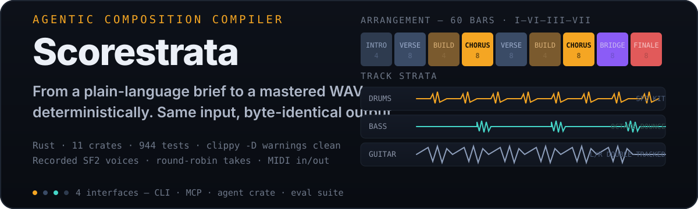
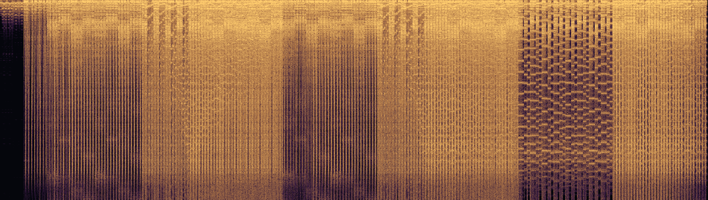
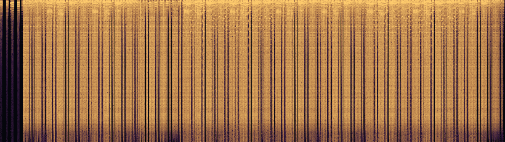
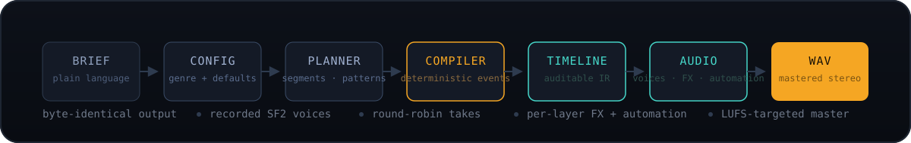

<p align="center">
  
</p>

<p align="center">

<a href="https://github.com/ishan-parihar/scorestrata/actions/workflows/ci.yml"></a>
  <a href="https://www.rust-lang.org"></a>
  
  
  <a href="./LICENSE"></a>
</p>

**Scorestrata is a deterministic, auditable music-generation compiler.** Describe a track in plain language — to an AI agent over MCP or to the `ss` CLI — and Scorestrata plans a layered arrangement, compiles it into an event-sourced timeline, and renders a mastered stereo WAV using **recorded instruments**. The same brief produces byte-identical audio, every time, on every machine.

---

## Hear it — two gold-standard demos

Both renders below are produced end-to-end by Scorestrata: a 60-bar nu-metal track in the style of the *Hybrid Theory* era, and a 44-bar nu-disco track in the pocket of a *Get Lucky*–style groove. Each is compiled from a project contract, voiced by recorded SF2 samples, and mastered to −14 LUFS with zero clipping.

<p align="center">
  
</p>

<p align="center"><sub><b>LP nu-metal</b> — 60 bars · I–VI–III–VII · 137 s · −14.0 LUFS · double-tracked guitars, recorded SF2 kit</sub></p>

<p align="center">
  
</p>

<p align="center"><sub><b>Nu-disco</b> — 44 bars · 116 BPM · B Dorian · 91 s · −14.0 LUFS · 4-on-the-floor kit, clean funk stabs</sub></p>

Regenerate them anytime:

```bash
python3 scripts/gen_lp_golden.py && python3 scripts/gen_nu_disco.py
ss render demos/lp_nu_metal        # or: ss render demos/nu_disco
```

Every render ships with **evidence, not promises**: `ss analyze` prints per-layer spectral fingerprints (centroid, rolloff, band energy, aliasing), and `ss audit` writes per-layer spectrograms you can look at.

---

## Why a *compiler* for music?

Most generative-music tools are samplers with RNG inside: the same prompt gives you a different take every time, and nothing about the result can be audited or reproduced. Scorestrata is built on the opposite assumptions:

- **Deterministic** — a `Project` contract compiles to a timeline event stream with no hidden randomness. Identical input → byte-identical WAV, on any machine, at any time.
- **Contract-first** — `Project`, `Segment`, `Layer`, and the mixer are typed contracts. The audio engine renders *against* the contract; the validator enforces it.
- **Event-sourced** — the timeline IR is a replayable event stream. `ss trace`, `ss replay`, and `ss diff` let you inspect exactly what happened at every stage.
- **Recorded instruments, not sine-waves** — a recorded SF2 bank (kick, snare, hats, toms, crash, ride, guitars, bass, e-piano, strings, brass, organ, leads, pads) with **round-robin takes** and **double-tracked guitar pairs**, so repeated notes sound like a real performance instead of machine-gunning one sample.
- **Agent-native** — the entire pipeline is exposed as MCP tools, so any agent can compose, render, and audit tracks in-conversation, with per-render receipts.

## How it works

<p align="center">
  
</p>

A brief goes through config generation (genre detection + defaults), planning (segments, patterns, layers), and deterministic compilation into a timeline IR. The audio engine voices it with recorded samples and per-layer FX chains, then the master bus targets a loudness spec. At every stage the IR is inspectable, validatable, and replayable.

## Quick start

```bash
git clone https://github.com/ishan-parihar/scorestrata.git
cd scorestrata
cargo build --release -p scorestrata-cli

# render a shipped gold-standard demo
./target/release/ss render demos/lp_nu_metal
./target/release/ss analyze demos/lp_nu_metal      # per-layer spectral audit
./target/release/ss audit demos/lp_nu_metal         # spectrogram PNGs per layer

# describe a track from scratch
./target/release/ss new "midnight drive" --brief "an 80s synthwave track, 116 BPM, pulsing bass, arpeggio lead, cinematic pads"
./target/release/ss render "midnight drive"

# MIDI in and out
./target/release/ss export-midi demos/lp_nu_metal --output lp.mid
./target/release/ss import-midi lp.mid --output lp-reimported
./target/release/ss render lp-reimported
```

The CLI is one of **four interfaces**:

| Interface | Purpose |
|-----------|---------|
| `ss` CLI | operator-driven composition, rendering, MIDI, and auditing |
| **MCP server** | agent-driven composition in-conversation (`scorestrata-mcp`) |
| **agent crate** | programmatic composition API |
| **eval suite** | automated quality scoring against gold-standard demos |

## What's inside

```
crates/
├── scorestrata-core       # domain contract: Project, Segment, Layer, mixer
├── scorestrata-theory     # harmony, rhythm, structure
├── scorestrata-compiler   # brief → timeline IR, MIDI import/export
├── scorestrata-validator  # contract + audio + genre enforcement
├── scorestrata-audio      # recorded SF2 voices, FX chains, mastering, analysis
├── scorestrata-storage    # event-sourced persistence, snapshots, provenance
├── scorestrata-agent      # programmatic composition API
├── scorestrata-mcp        # MCP tool surface for agents
├── scorestrata-cli        # the `ss` binary
├── scorestrata-eval       # golden-harness quality scoring
└── scorestrata-testkit    # fixtures and helpers

demos/          # gold-standard projects (lp_nu_metal, nu_disco) + renders
eval/golden/    # reference contracts for the eval harness
docs/           # architecture, plans, and live system audits
scripts/        # deterministic demo generators
```

## Capabilities

- **Genre engine** — detection, defaults, fingerprints, arrangement templates, and production playbooks (nu-metal, nu-disco, pop, funk, jazz, hip-hop, dnb, cinematic, synthwave, lo-fi, and more)
- **Recorded instrument bank** — 101 WAV assets extracted from a GM SF2, with looped sustained voices, round-robin guitar takes, and a full drum kit (kick, snare, closed/open hats, clap, toms, crash, ride)
- **Double-tracked guitars** — independent L/R takes at tick-level offsets (measured 0.005–0.08 correlation: real takes, not pan copies)
- **MIDI round-trip** — export any project to `.mid`, re-import it as a project, and re-render it identically (BPM, time signature, and 2,592-note arrangements preserved)
- **Per-layer mixing & automation** — FX chains, CC7 volume automation, mix chains per production family
- **Mastering** — LUFS/crest-targeted stereo master with clipping checks
- **Audit tooling** — per-layer spectral reports + spectrogram PNGs on the timeline (`ss audit`, `audit_layer_spectral` MCP tool)

## Quality gate

Every push is validated remotely in CI — a local-only green is not the gate:

```bash
cargo test --workspace            # 944 tests passing
cargo clippy --workspace --all-targets -- -D warnings   # zero warnings
cargo fmt --all -- --check
```

The eval suite also pins the gold-standard demos: compile, validate, and render gates must pass against `eval/golden/` reference contracts before a demo can drift.

## Docs

- [`docs/architecture/architecture.md`](docs/architecture/architecture.md) — system architecture
- [`docs/system-audit-report.md`](docs/system-audit-report.md) — live system-status audit
- [`docs/planning/re-architecture-upgrade-plan.md`](docs/planning/re-architecture-upgrade-plan.md) — the upgrade plan behind the current phase
- [`docs/planning/organic-character-verification.md`](docs/planning/organic-character-verification.md) — DSP evidence for the recorded-instrument sound

## License

MIT — see [`LICENSE`](LICENSE).

---

## ☕ Support & Sponsorship

If you find this project useful, consider supporting ongoing development:

[](https://github.com/sponsors/ishan-parihar)
[](https://rzp.io/rzp/ishan-parihar)

Your support funds new features, releases, and infrastructure for the whole ecosystem.
